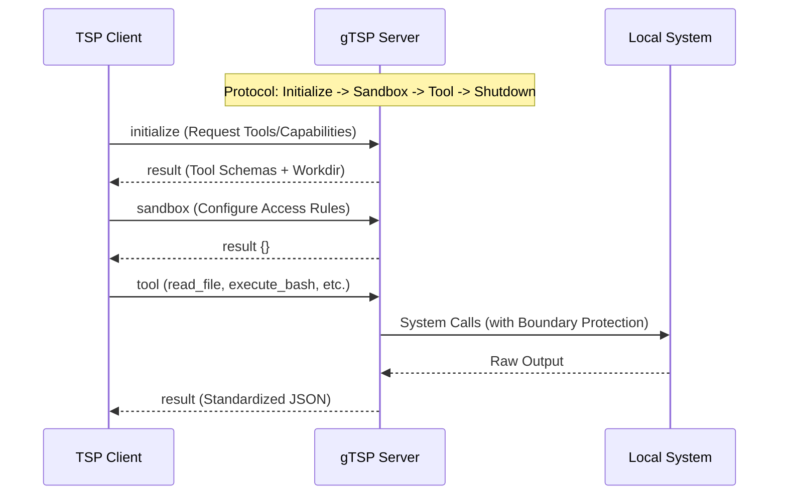

# gTSP

[English](README.md) | [中文](README.zh.md)

gTSP is a high-performance, zero-dependency reference implementation of the [Tool Server Protocol (TSP)](https://github.com/alexazhou/TSP). It provides standardized tool execution capabilities for Large Language Models (LLMs) via JSON over `stdio` or `WebSockets`.

### Core Features

- **Single-file Distribution**: Compiled into a single binary for easy deployment.
- **Cross-platform**: Supports Windows, macOS, and Linux.
- **Zero Dependencies**: No runtime or environment requirements.
- **Dual-mode Communication**: Supports both `stdio` and `WebSockets` transports.
- **Safety First**: Per-session sandbox with PathRule (allow/deny) matching.

### Interaction Protocol



### Quick Start

#### Compilation
```bash
go build -o gtsp src/main.go
```

For Linux binaries (e.g. to be shipped into containers), build a **fully static** binary so it does not depend on the host image's glibc/musl:
```bash
CGO_ENABLED=0 GOOS=linux GOARCH=amd64 go build -ldflags="-s -w" -o gtsp-linux-amd64 src/main.go
# or use the build script (linux targets default to CGO_ENABLED=0 and -ldflags="-s -w", matching the CI release flags)
./script/build.sh linux/amd64 linux/arm64
# disable stripping when you need debug symbols: STRIP=0 ./script/build.sh linux/amd64
```

#### Running
```bash
./gtsp --mode stdio
```

#### Windows: the shell and `busybox64u.exe`

Windows has no native `sh`/`bash`. The Windows build of gTSP therefore ships
with **busybox-w32** as a companion binary, and `execute_bash` runs commands as
**POSIX `sh`** (busybox `ash`) instead of bash.

> **Release layout — put both files in the same directory:**
> ```
> gtsp-windows-amd64.exe
> busybox64u.exe          <- required, no install needed
> ```
> If `busybox64u.exe` is missing, gTSP falls back to `bash` from `PATH`
> (e.g. Git for Windows). It **refuses** the WSL stub
> `C:\Windows\System32\bash.exe`: that one runs commands inside a Linux VM with
> a separate filesystem, so `execute_bash` and `read_file`/`write_file` would
> see two different worlds. To use WSL, run the **Linux build of gTSP inside WSL**
> instead of the Windows build.

Because the shell is POSIX `sh`, **bash-only syntax is not available**:
`[[ ... ]]`, arrays (`arr=(a b c)`), brace expansion (`{1..10}`), `$'...'`.
Use POSIX equivalents: `[ ... ]`, `$(seq 1 10)`, `while` loops.

Guaranteed applets: busybox-w32 implements well over a hundred Unix commands, so
`ls cat grep sed awk find sort uniq head tail wc tr cut mv cp rm mkdir touch date
sleep printf echo test ps kill xargs which env` work **regardless of what the
user has installed**. Windows CI asserts a core subset
(`ls cat grep sed awk find sleep ps kill tr`) on every run; the full applet list
is whatever `busybox64u.exe --list` reports for the shipped version.

Two escape hatches:

| Variable | Effect |
| :--- | :--- |
| `GTSP_BUSYBOX` | Absolute path to a specific busybox binary (overrides lookup) |
| `GTSP_BUSYBOX_X=1` | Add busybox `-X`: stop busybox from converting backslashes to forward slashes. Only matters when a backslash reaches busybox as a literal argument — it does **not** rescue `cd \some\path`, because the shell consumes the backslashes first |

**Path rules (measured on windows-latest, see `busybox_windows_probe_test.go`):**

| Write this | Result |
| :--- | :--- |
| `c:/work/file.txt` | ✅ works, and `pwd` also reports `c:/...` style |
| `/c/work/file.txt` | ❌ `can't cd to /c/: No such file or directory` — the Cygwin/MSYS form does **not** work here |
| `cd c:/`, `cd c:\`, `cd C:` | ✅ all work |
| `C:\Windows` unquoted | ⚠️ becomes `C:WindowsSystem32`-style — the **shell** eats the backslashes. Quote it or use forward slashes |

Do not rely on `cd /d/`. Use `cd d:/`.

Busybox-w32 prefers its **built-in applets over external programs** on `PATH`.
To force an external program, set `BB_OVERRIDE_APPLETS` (space-separated), e.g.
`BB_OVERRIDE_APPLETS=make`.

#### Interaction Example (stdin)
Send a JSON request to the program (newline required):
```json
{"id": "1", "method": "initialize", "input": {"protocolVersion": "0.3"}}
```

### Toolset (TSP v0.3)

| Method | Description | Key Parameters | Features |
| :--- | :--- | :--- | :--- |
| `list_dir` | Explore directory structure | `dir_path`, `recursive`, `depth` | Default ignores `.git`, returns rich metadata. |
| `read_file` | Read file with safety | `file_path`, `start_line`, `end_line` | **Line-based slicing**, 100KB limit, binary protection. |
| `write_file` | Atomic full write | `file_path`, `content` | **Atomic write** (temp file rename), auto `mkdir -p`. |
| `edit` | Precision string edit | `file_path`, `old_string`, `new_string` | **Safe replacement**, ensures unique match before applying. |
| `grep_search` | High-speed code search | `pattern`, `dir_path`, `fixed_strings` | Supports Regex/Literal, result truncation for context safety. |
| `glob` | File path matching | `pattern`, `path` | Fast lookup using glob patterns (e.g., `src/**/*.go`). |
| `execute_bash` | Execute system command | `command`, `task_timeout` | **Output truncation** (50KB/1000 lines), background task support. |

---

### Design Philosophy

The core philosophy of gTSP is **"Capability Isolation"**. By encapsulating complex system calls, path validations, and command execution logic within the Go layer, the Agent's logic layer remains pure and secure.

For the protocol definition, visit the [TSP Specification Repository](https://github.com/alexazhou/TSP).

### License

MIT
